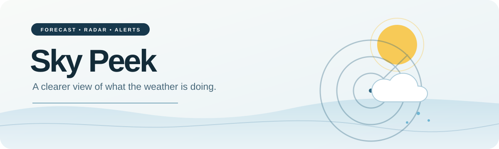

<div align="center">
  

  <p><strong>See the forecast. Explore the radar. Understand what is headed your way.</strong></p>
  <p>Sky Peek brings weather forecasts, live radar, and official alerts together for places across the United States.</p>

  <p>
    <a href="https://github.com/brainitchstudio/skypeek/actions/workflows/verify.yml"></a>
    &nbsp; Next.js 16 · React 19 · MapLibre GL · Node.js 22
  </p>
</div>

## A useful view of the weather

The main screens keep the everyday forecast simple: **Today**, **Hourly**, and **10 Day**. Open **Radar** when you want the detail behind it. Choose a place, step through real scan times, inspect a storm, and see active National Weather Service alerts on the map.

| Explore | What you can do |
| --- | --- |
| **Forecasts at a glance** | Check current conditions, the next hours, and a 10 day outlook for saved US places. |
| **Radar with context** | Use NOAA national or station radar, or RainViewer. Play real frames, switch between a flat map and satellite imagery, and turn on storm, lightning, wind, temperature, and alert layers. |
| **A look ahead** | Continue NOAA national radar playback into clearly labeled HRRR model forecast frames for up to 18 hours. These are simulated weather, separate from observed radar. |
| **Storm SpotCheck** | Select a storm outline and a spot on the map to see a movement based arrival estimate, the spot forecast, and active warnings. You can also check a spot on its own. |
| **Official alerts and lightning awareness** | Read NWS warnings and advisories in the places they affect. Nearby lightning activity can trigger a prominent shelter notice. |
| **Places that matter to you** | Search cities, ZIP codes, and US street addresses; save favorites and choose a main location. |
| **A guided first visit** | Each beta code starts by choosing a main location, previewing it on a map, and confirming it. A five-screen tour uses real desktop and mobile previews against the same weather scene shown at the beta entrance. Returning visitors see release notes when the app version advances. The tour and notes can be reopened from Settings. |

## Why Sky Peek is different

**The map tells you what you are looking at.** Radar frames show their time and source. Historical storm reports stay aligned with their selected frame when available, while live overlays are labeled as live. HRRR frames are marked as model forecasts. Missing data is shown as unavailable instead of filled with invented measurements.

**Forecast sources are used with care.** The National Weather Service provides the baseline. Optional connected providers can add comparable forecasts, while caching and request budgets keep routine use measured. Official alerts have their own path, so a forecast source failure does not silently erase them.

**Accuracy can be checked over time.** Sky Peek keeps forecast and nearby observation records in your browser and offers an experiment dashboard at `/lab`. It reports coverage and error alongside request use. These records are descriptive; the app does not automatically change its forecast weights.

> [!NOTE]
> Sky Peek is in beta and currently focuses on US locations. Storm movement and lightning proximity are estimates. For severe weather decisions, follow official [National Weather Service](https://www.weather.gov/) guidance.

## Run it locally

Use Node.js 22 and npm:

```bash
npm ci
npm run dev
```

Open [localhost:3000](http://localhost:3000). Run `npm test` for the test suite and `npm run build` to check a production build. With no beta variables configured, local development opens without the access gate.

## Deploy a private beta

This public repository contains the source. The app itself uses a server side beta access gate, so deploy it as a **Node.js Web App** with HTTPS and runtime environment variables. A static site upload cannot run its API routes or access gate.

| Server only variable | Purpose |
| --- | --- |
| `BETA_ACCESS_CODE_HASHES` | Comma-separated salted hashes of shared access codes. Takes priority over `BETA_ACCESS_CODE`. |
| `BETA_ACCESS_CODE` | Optional plaintext fallback for older deployments; remove it after setting the hash. |
| `BETA_SESSION_SECRET` | Signs access sessions and generated codes. |
| `BETA_ADMIN_CODE` | Opens the owner code manager at `/beta-admin`. |

Set real values in the host dashboard, never in GitHub. The owner page can generate separate access codes valid for 7, 30, or 90 days without a database. Codes are reusable until expiry; there is no per-code revocation or tester account list in this beta.

See the [deployment guide](docs/hostinger-deployment.md) for GitHub and Hostinger setup, and the [beta gate notes](docs/beta-code-gate-plan.md) for access behavior and limitations.

### Publishing an update

Advance the version in `package.json` and `package-lock.json` with `npm version <next-version> --no-git-tag-version`, then add that version's notes to `src/lib/releases.ts`. A returning visitor sees the notes for versions newer than the last version they opened. Tour completion is remembered per access code in that browser's local storage. A new browser or cleared site data starts the location choice and tour again.

## Data and project notes

Sky Peek uses NWS and NOAA weather data, Open-Meteo for extended forecasts and place search, OpenStreetMap data through OpenFreeMap, and radar sources including NOAA and RainViewer. Optional OpenWeather, Tomorrow.io, WeatherAPI, and individual lightning products require suitable provider access. Full provider credits appear in **Settings → Data source** and map attribution remains on the radar.

Interface icons are from [Lucide](https://lucide.dev/); weather icons are [Meteocons](https://www.npmjs.com/package/@meteocons/svg-static). For source behavior, measurement limits, and radar implementation details, read the [technical notes](docs/technical-notes.md).
